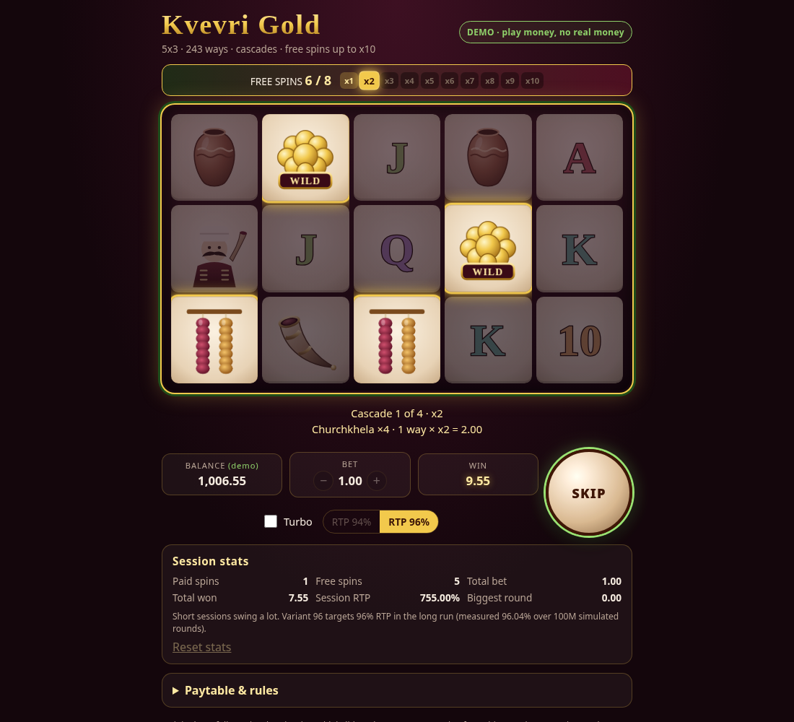
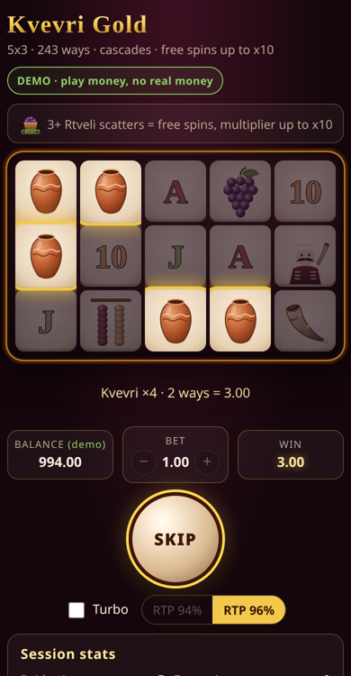
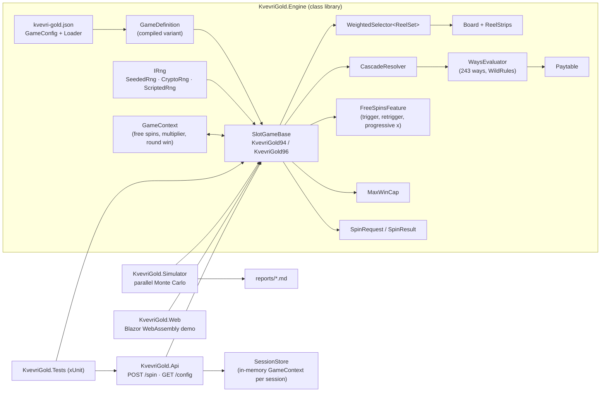

# Kvevri Gold: slot game server engine and RTP simulator (C# / .NET 8)

[](../../actions/workflows/ci.yml)

**Kvevri Gold** is a Georgian-wine-themed **5x3, 243-ways cascading slot** written from scratch as a
portfolio project. It covers the work an iGaming game-logic developer does day to day:

- a **stateless, deterministic game engine** with an injectable RNG, data-driven math (JSON) and two RTP variants,
- a **parallel Monte Carlo simulator** that verifies the game math (RTP split, hit rate, volatility,
  win distribution, confidence interval) and writes a markdown report,
- a small **ASP.NET Core API** that serves spins with per-session state (free spins survive between requests),
- **xUnit tests** with hand-built boards for every rule, plus a statistical RTP test,
- a **playable browser demo** (Blazor WebAssembly) that runs this same engine client-side.

## ▶ Play it

**[giorgimaghlakelidze.github.io/kvevri-gold](https://giorgimaghlakelidze.github.io/kvevri-gold/)**: demo balance only, no real money.

<p>
  <a href="https://giorgimaghlakelidze.github.io/kvevri-gold/"></a>
  <a href="https://giorgimaghlakelidze.github.io/kvevri-gold/"></a>
</p>

The page is a Blazor WebAssembly app (`src/KvevriGold.Web`) that references `KvevriGold.Engine` directly, so every spin
in the browser goes through the same tested C# code as the simulator, using the browser's cryptographic RNG. It has
winning-ways highlights, cascades animated step by step, free spins with the x1 to x10 multiplier meter, a 94/96 RTP
switch, turbo and skip, and session stats (spins, total bet, total won, session RTP). Add `?seed=1155` to the URL
for a reproducible seeded session that opens with free spins. All symbol art is original SVG drawn for this project.
Every push to `main` deploys it to GitHub Pages through [`pages.yml`](.github/workflows/pages.yml).

> **Honest note:** this is a personal portfolio project, not a licensed or certified game. The math was designed
> and tuned by me with the included simulator. It has not been through an accredited test lab (GLI, BMM, iTech Labs),
> and the API has no auth, wallet or persistence. All code, math and theme are original.

## Measured results

Real runs of `KvevriGold.Simulator` on this repository (8 threads, seed `20251116` unless marked CSPRNG).
Full reports are in [`reports/`](reports).

| Variant | Target | Rounds | RNG | **Measured RTP** | 95% CI | Base / Free spins | Hit freq | FS trigger | Avg FS win | Std dev | Max win seen |
|---|---|---:|---|---:|---|---|---|---|---|---|---|
| 94 | 94.00% | 100M | seeded | **93.966%** | ±0.103 pp | 69.96% / 24.01% | 40.51% | 1 in 138.6 | 33.3x | 5.24 | 1,557x |
| 94 | 94.00% | 10M | seeded | **94.149%** | ±0.326 pp | 69.98% / 24.17% | 40.52% | 1 in 138.1 | 33.4x | 5.25 | 995x |
| 94 | 94.00% | 10M | CSPRNG | **94.004%** | ±0.327 pp | see report | | | | | |
| 96 | 96.00% | 100M | seeded | **96.035%** | ±0.104 pp | 71.53% / 24.50% | 40.86% | 1 in 136.0 | 33.3x | 5.31 | 1,557x |
| 96 | 96.00% | 10M | seeded | **95.985%** | ±0.326 pp | 71.49% / 24.50% | 40.87% | 1 in 135.6 | 33.2x | 5.26 | 995x |
| 96 | 96.00% | 10M | CSPRNG | **95.975%** | ±0.329 pp | see report | | | | | |

Every run lands within ±0.3 pp of its target. With a per-round standard deviation of about 5.3x bet, the
statistical noise of a 10M run is about ±0.33 pp (95%), so the math was tuned on 200M-round runs, where it is
about ±0.07 pp. The two seeded variants show the same max win because the variants share free-spins
reels and the same seed streams. The 5,000x cap was never reached in these runs, so it is a safety limit
rather than part of the RTP.

## Game rules

| | |
|---|---|
| Layout | 5 reels x 3 rows, **243 ways**, pays left to right from reel 1 on adjacent reels |
| Bet | 1 bet = 20 coins; pays below are per way, in multiples of the total bet |
| Cascades | Winning symbols (including wilds used in a win) are removed, the rest fall, and new symbols drop from the reel strip above. Repeats until there is no win. |
| Wild | **Golden Fleece** (W), reels 2-5 only, substitutes for every symbol except the scatter, no pay of its own |
| Scatter | **Rtveli Basket** (S), pays anywhere, counted after the cascades finish: 3 = 2x, 4 = 10x, 5+ = 50x bet |
| Free spins | 3 / 4 / 5+ scatters award **8 / 12 / 15** free spins at the triggering bet |
| Retrigger | 3 / 4 / 5+ scatters during free spins add **5 / 8 / 10** spins |
| Progressive multiplier | Starts at x1 when free spins begin. Every winning cascade raises it by 1 (max **x10**), and it never resets until the feature ends. Applies to way wins, not scatter pays. |
| Max win | **5,000x** bet per round (base spin plus its free spins). When it is hit, the round ends and the remaining free spins are forfeited. |

### Paytable (x total bet, per way)

| Symbol | Code | 3 | 4 | 5 |
|---|---|---:|---:|---:|
| Tamada (toastmaster) | TA | 1.00 | 3.00 | 10.00 |
| Kantsi (wine horn) | KN | 0.75 | 2.00 | 7.50 |
| Kvevri (clay wine vessel) | KV | 0.50 | 1.50 | 5.00 |
| Churchkhela | CH | 0.40 | 1.00 | 4.00 |
| Grapes | GR | 0.30 | 0.75 | 3.00 |
| A / K | A, K | 0.20 | 0.50 | 1.50 |
| Q | Q | 0.15 | 0.40 | 1.25 |
| J | J | 0.10 | 0.30 | 1.00 |
| 10 | T | 0.10 | 0.25 | 1.00 |

### RTP variants

Both variants use the same paytable and free-spins reels. They differ only in how often each base-game
reel set is picked, which is how a studio typically ships several RTP versions of one game:

| Variant | `base_harvest` (rich, ~107.7% when selected) | `base_cellar` (lean, ~74.8% when selected) | `free_rtveli` |
|---|---:|---:|---:|
| 94 | 58.3% (weight 583) | 41.7% (weight 417) | 100% |
| 96 | 64.4% (weight 644) | 35.6% (weight 356) | 100% |

Because RTP is linear in the reel-set weights, tuning works in two steps: measure each reel set on its own, then
solve for the weights. See `tools/generate_config.py`.

## Architecture



Design choices:

- **No hidden state or randomness in the engine.** A game instance is immutable and thread-safe. Player state lives in
  `GameContext`, and every random draw goes through the injected `IRng`. That is what makes spins replayable, the
  simulator parallel, and the tests exact (`ScriptedRng` forces reel stops).
- **Data-driven math.** Symbols, paytable, feature rules, reel strips and variant weights are in
  `src/KvevriGold.Engine/Config/kvevri-gold.json`, embedded in the assembly. Config is validated at load
  (for example, wilds are rejected on reel 1).
- **Variants as subclasses** (`KvevriGold94`, `KvevriGold96`) over a generic `SlotGameBase`, created through `GameFactory`.
- **Real cascades.** Refills continue up the actual reel strip, not random symbols, so the math stays tied to the strips.
- **Fast path for simulation.** `Spin(..., captureDetails: false)` skips board snapshots. Wins are integer coins,
  and the simulator runs about 9 million rounds per second on 8 cores.
- **RNG.** `CryptoRng` (OS CSPRNG via `RandomNumberGenerator.GetInt32`) is used for live play.
  `SeededRng` (xoshiro256** seeded through SplitMix64, with unbiased Lemire bounded integers) is used for reproducible
  simulation, with one independent stream per thread.

## Project layout

```
src/KvevriGold.Engine/      game engine (RNG, config, math, features, protocol)
src/KvevriGold.Simulator/   console RTP simulator, markdown reports
src/KvevriGold.Api/         minimal ASP.NET Core API
src/KvevriGold.Web/         playable Blazor WebAssembly demo (runs the engine in the browser)
tests/KvevriGold.Tests/     xUnit tests
tools/generate_config.py    reproducible reel-strip / config generator (tuning knobs)
reports/                    measured simulation reports
```

## Running it

Requires the [.NET 8 SDK](https://dotnet.microsoft.com/download/dotnet/8.0).

```bash
dotnet build -c Release
dotnet test  -c Release                      # 52 tests, including 1M-round RTP checks per variant

# RTP simulation (10M rounds, 8 threads); writes reports/rtp-96-10M-seed42.md
dotnet run -c Release --project src/KvevriGold.Simulator -- --variant 96 --spins 10000000 --seed 42 --threads 8

# Other options: --rng crypto (OS CSPRNG), --config path/to.json, --out dir, --quiet, --help
```

Seeded results are reproducible for the same seed **and** thread count.

### Browser demo

```bash
dotnet run --project src/KvevriGold.Web      # then open the printed http://localhost URL
```

### API

```bash
dotnet run -c Release --project src/KvevriGold.Api --urls http://localhost:5080

curl http://localhost:5080/config?variant=96
curl -X POST http://localhost:5080/spin -H 'content-type: application/json' \
     -d '{"bet": 1.00, "variant": "96"}'
# reuse the returned sessionId; while free spins are pending, each /spin plays the next free spin at no cost
curl -X POST http://localhost:5080/spin -H 'content-type: application/json' \
     -d '{"bet": 1.00, "sessionId": "<id from previous response>"}'
```

The spin response contains the reel set and stops, the initial board, every cascade step (board, winning ways with
positions, multiplier, win), scatters, free-spin counters, the round win and the demo balance (sessions start at 1,000).
`/config` returns the rules and paytable but not the reel strips.

### Re-tuning the math

```bash
python3 tools/generate_config.py          # rebuilds Config/kvevri-gold.json from the counts and weights in the script
dotnet run -c Release --project src/KvevriGold.Simulator -- --variant 94 --spins 200000000 --quiet
```

The report's "RTP by base reel set" table gives the RTP of each base reel set, which is all you need to solve for new weights.

## Tests

| Area | What is checked |
|---|---|
| Ways evaluator | Hand-built boards: 3/4/5 of a kind, way multiplication, left-to-right only, multiple symbols, win masks |
| Wilds | Substitution creates extra ways, wilds cannot start a way on reel 1, never substitute for the scatter, are removed when part of a win, are rejected on reel 1 in config |
| Cascades | Drop and refill order from the strip above the window, chained cascades, progressive multiplier per winning cascade and its cap |
| Free spins | Trigger with 3/4/5 scatters, scatter pays, no charge during free spins, locked bet, countdown, retrigger, multiplier reset |
| Max win cap | Round win capped at 5,000x, remaining free spins forfeited, never exceeded in 200k simulated rounds |
| RNG | Seeded determinism, independent streams, range checks, chi-square uniformity, full-game replay determinism, scripted RNG |
| Statistics | 1,000,000 rounds per variant within 4 standard errors of target RTP |
| Browser demo session | Play-money balance and stats match the engine, free spins are not charged and lock bet and variant, seeded replay equals the engine, bet ladder and refill |
| API | `/config` hides strips, `/spin` keeps the session and balance, rejects invalid bets and variants |

## Possible next steps

- Sound, and a Unity client driven by the API's `/spin` response.
- Exact (combinatorial) RTP calculation for the base game without cascades, to cross-check the simulator.
- Persistence for sessions and an audit log of RNG draws per spin for replay.
